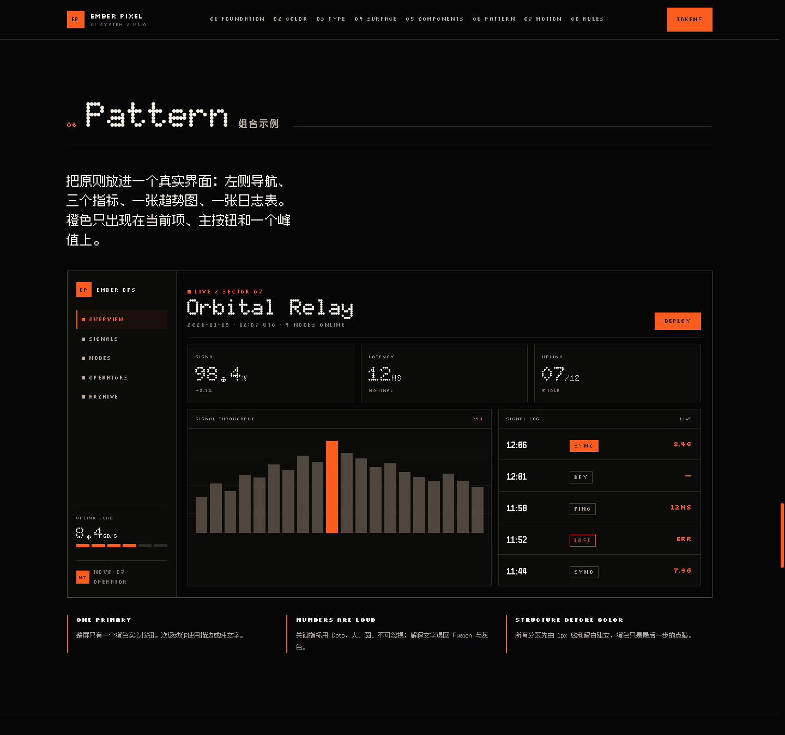

# Ember Pixel

**黑底 · 橙光 · 点阵**

一套为深色界面设计的像素化 UI 系统，也是一个可以直接安装的 DSH Skill。色彩取自参考海报的 `#FC5C1E`，由 Doto、Silkscreen、Fusion Pixel 三套点阵字体构成。


## 它是什么

Ember Pixel 不是一套“复古游戏皮肤”，而是一套有明确约束的界面语言：

- **黑是画布**：`#060606` 占约 90%，层级靠 1px 线、留白与字号，而不是一层层灰阶面板。
- **橙是信号**：`#FC5C1E` 只给主行动、当前项、LIVE 状态和关键数字，单屏面积 ≤10%。
- **点是骨架**：Doto 的圆点展示字、Silkscreen 的像素 UI、Fusion Pixel 的中文正文。
- **硬边结构**：0 圆角、1px/2px 边框、8px 网格、4px 硬投影。
- **继电器动效**：90/160/320ms + `steps()`，没有回弹、模糊和 `scale(1.1)`。



## 快速开始

### 作为 DSH Skill

```bash
git clone https://github.com/seaison/ember-pixel.git ~/.dsh/skills/ember-pixel
```

新开一个 DSH 会话，然后直接说：

> 用 ember-pixel 做一个数据控制台

### 作为前端样式库

```html
<link rel="stylesheet" href="assets/ember.css">
```

把 `assets/ember.css` 与 `assets/fonts/` 一起复制到项目，保持相对路径（CSS 用 `./fonts/` 引用字体）。

### 打开视觉规范

浏览器直接打开 [`assets/styleguide.html`](assets/styleguide.html)。页面完全离线，包含 8 个章节和可交互的 Tabs / Dialog / Toast / 移动端菜单。

## 调色板

| Token | Hex | 用途 |
| --- | --- | --- |
| `--ep-bg` | `#060606` | 画布 |
| `--ep-panel` | `#0B0B0A` | 卡片、输入框、表头 |
| `--ep-ember` | `#FC5C1E` | 主行动、当前项、关键数字 |
| `--ep-cream` | `#F7F1E7` | 正文与标题 |
| `--ep-muted` | `#B7AC9E` | 次级文本 |
| `--ep-dim` | `#8A7F72` | 提示、占位符 |
| `--ep-danger` | `#FF3B24` | 仅破坏性操作与错误 |

**两条不可违反的对比度规则**：橙色上只用近黑字（6.4:1），奶油白永远不上橙底（2.8:1）。

## 字体

| 角色 | 字体 | 尺寸 |
| --- | --- | --- |
| Display | Doto 900 | 32–260px，仅拉丁 |
| UI | Silkscreen 400 | 8–16px，全大写 |
| Body | Fusion Pixel | 12 / 16 / 24 / 36px，中文 |

所有字体均为 SIL Open Font License 1.1，许可全文在 [`assets/fonts/`](assets/fonts/)。

## 核心规则

1. 0 圆角；圆形只出现在状态点和头像上。
2. 8px 间距网格；容器 1280，12 列，24 gutter。
3. 一个视口只有一个橙色实心主按钮。
4. Doto 只做 ≥32px 的展示字；中文用 Fusion。
5. 动效只用 `steps()`，不动宽高、margin、filter。
6. Hover 仅在 `(hover: hover)` 下生效；焦点环 2px 橙圈 + 3px offset。
7. 图标 16×16、2px 笔画、`crispEdges`。

完整规则、组件配方和交付前 QA 见 [`SKILL.md`](SKILL.md)。

## 目录

```
.
├── SKILL.md                  # Skill 规则与配方
├── README.md
├── assets/
│   ├── ember.css             # token + 组件库
│   ├── styleguide.html       # 视觉规范
│   └── fonts/                # Doto / Silkscreen / Fusion Pixel + OFL
└── docs/
    ├── preview-hero.png
    └── preview-dashboard.png
```

## License

字体遵循 SIL Open Font License 1.1；其余代码与文档版权归作者所有。
