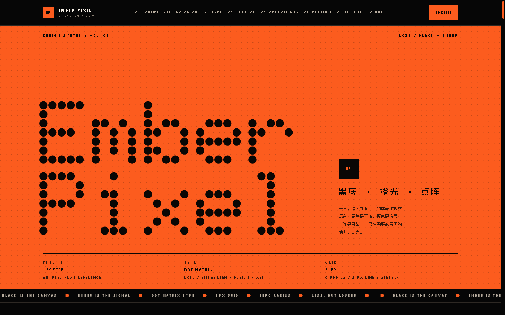

# Ember Pixel

**黑底 · 橙光 · 点阵**

一套与工具、框架无关的深色 UI 设计系统，也是一个可以被任意 Agent 读取的 Skill。色彩取自参考海报的 `#FC5C1E`，由 Doto、Silkscreen、Fusion Pixel 三套点阵字体构成。

**[在线浏览视觉规范 →](https://seaison.github.io/ember-pixel/)**



## 为什么是三个入口

没有一种文件格式能被所有 Agent 原生识别。Ember Pixel 把同一套规范拆成三个入口，内容保持一致：

| 文件 | 用途 |
| --- | --- |
| [`SKILL.md`](SKILL.md) | **唯一事实源**。支持 `SKILL.md` / Agent Skills 的工具：DSH、Claude Code 等 |
| [`AGENTS.md`](AGENTS.md) | **通用摘要**。给 Codex、Cursor、Windsurf 等读取 `AGENTS.md` 的 Agent |
| [`prompt.md`](prompt.md) | **独立提示词**。给 ChatGPT / Claude / Gemini 等只能粘贴文本的对话 |

有冲突时以 `SKILL.md` 为准。

## 安装 / 使用

### DSH

```bash
git clone https://github.com/seaison/ember-pixel.git ~/.dsh/skills/ember-pixel
```

### Claude Code

```bash
# 个人级
git clone https://github.com/seaison/ember-pixel.git ~/.claude/skills/ember-pixel

# 或项目级：放进 <project>/.claude/skills/ember-pixel/
```

`SKILL.md` 的 frontmatter 遵循 Agent Skills 约定，Claude Code 会像读取原生 skill 一样读取它。

### Codex / Cursor / Windsurf / 其他 AGENTS.md Agent

把整个仓库（或至少 `AGENTS.md` + `assets/`）放进项目，或让 Agent 直接读这个仓库的 `SKILL.md`。`AGENTS.md` 自带完整的非协商规则，即使只读这一个文件也能开始。

### ChatGPT / Claude / Gemini 网页版

打开 [`prompt.md`](prompt.md)，把分隔线之后的全部内容粘贴到对话开头，再描述需求。它是自包含的，不依赖仓库文件。

### 其他 Agent

- **Gemini CLI / Windsurf / Cline** 等：把 `AGENTS.md` 作为项目规则文件，或让 Agent 直接读 `SKILL.md`。
- **任何能读文件的 Agent**：先读 `SKILL.md`，再读 `assets/ember.css` 和 `assets/styleguide.html`。

### 普通前端项目

```html
<link rel="stylesheet" href="assets/ember.css">
```

把 `assets/ember.css` 与 `assets/fonts/` 一起复制到项目，保持相对路径（CSS 用 `./fonts/` 引用字体）。没有 npm、构建工具或运行时依赖。

## 在线浏览

完整视觉规范由 GitHub Pages 托管，无需克隆：

**[seaison.github.io/ember-pixel →](https://seaison.github.io/ember-pixel/)**

页面由 GitHub Pages 从 `main` 分支根目录托管，完全离线可用；要本地修改时，直接打开 `assets/styleguide.html`。

## 它是什么

Ember Pixel 不是一套“复古游戏皮肤”，而是一套有明确约束的界面语言：

- **黑是画布**：`#060606` 占约 90%，层级靠 1px 线、留白与字号，而不是一层层灰阶面板。
- **橙是信号**：`#FC5C1E` 只给主行动、当前项、LIVE 状态和关键数字，单屏面积 ≤10%。
- **点是骨架**：Doto 的圆点展示字、Silkscreen 的像素 UI、Fusion Pixel 的中文正文。
- **硬边结构**：0 圆角、1px/2px 边框、8px 网格、4px 硬投影。
- **继电器动效**：90/160/320ms + `steps()`，没有回弹、模糊和 `scale(1.1)`。


## 调色板

| Token | Hex | 用途 |
| --- | --- | --- |
| `--ep-bg` | `#060606` | 画布 |
| `--ep-panel` | `#0B0B0A` | 卡片、输入框、表头 |
| `--ep-ember` | `#FC5C1E` | 主行动、当前项、关键数字 |
| `--ep-cream` | `#F7F1E7` | 正文与标题 |
| `--ep-muted` | `#B7AC9E` | 次级文本 |
| `--ep-dim` | `#8A7F72` | 提示、占位符 |
| `--ep-danger` | `#FF3B24` | 仅破坏性操作与错误 |

**两条不可违反的对比度规则**：橙色上只用近黑字（6.4:1），奶油白永远不上橙底（2.8:1）。

## 字体

| 角色 | 字体 | 尺寸 |
| --- | --- | --- |
| Display | Doto 900 | 32–260px，仅拉丁 |
| UI | Silkscreen 400 | 8–16px，全大写 |
| Body | Fusion Pixel | 12 / 16 / 24 / 36px，中文 |

所有字体均为 SIL Open Font License 1.1，许可全文在 [`assets/fonts/`](assets/fonts/)。在线规范使用按页面字符裁切的 19KB 子集（`FusionPixel-12px-SC-web.woff2`），完整字体仍保留给项目使用。

## 核心规则

1. 0 圆角；圆形只出现在状态点和头像上。
2. 8px 间距网格；容器 1280，12 列，24 gutter。
3. 一个视口只有一个橙色实心主按钮。
4. Doto 只做 ≥32px 的展示字；中文用 Fusion。
5. 动效只用 `steps()`，不动宽高、margin、filter。
6. Hover 仅在 `(hover: hover)` 下生效；焦点环 2px 橙圈 + 3px offset。
7. 图标 16×16、2px 笔画、`crispEdges`。

完整规则、组件配方和交付前 QA 见 [`SKILL.md`](SKILL.md)。

## 目录

```
.
├── SKILL.md                  # 唯一事实源（Agent Skills 标准）
├── AGENTS.md                 # 通用 Agent 摘要
├── prompt.md                 # 无文件访问时的独立提示词
├── index.html                # Pages 入口，跳转到 assets/styleguide.html
├── README.md
├── assets/
│   ├── ember.css             # token + 组件库
│   ├── styleguide.html       # 8 章视觉规范
│   └── fonts/                # Doto / Silkscreen / Fusion Pixel + OFL
├── docs/
│   ├── preview-hero.png
│   └── preview-dashboard.png
└── .nojekyll                 # GitHub Pages 直接静态托管
```

## License

字体遵循 SIL Open Font License 1.1；其余代码与文档版权归作者所有。
